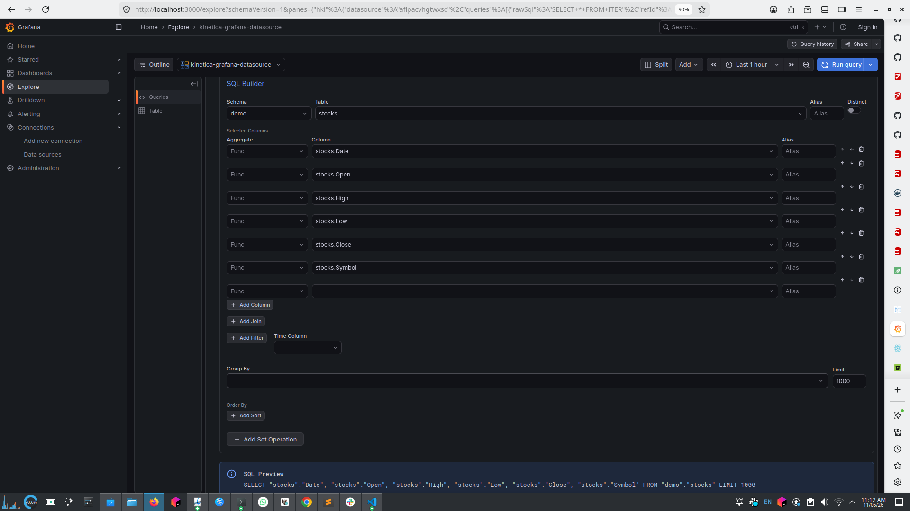
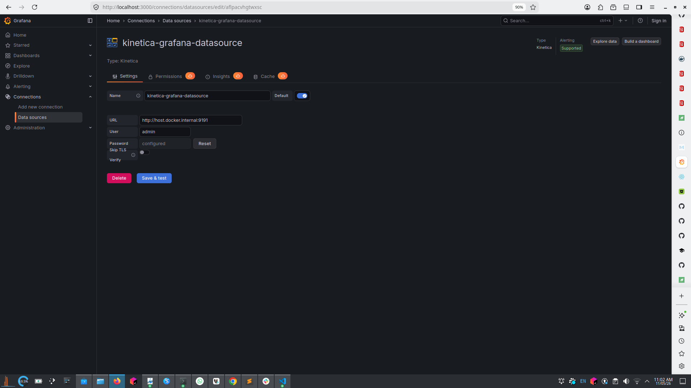
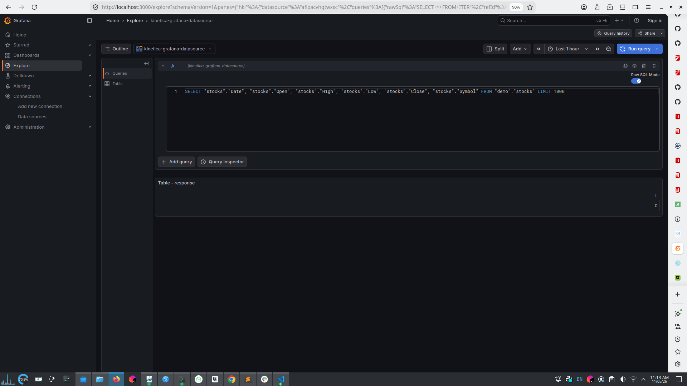

# Kinetica Datasource for Grafana

[](https://grafana.com)
[](https://grafana.com/grafana/plugins/kinetica-grafana-datasource)
[](https://grafana.com/grafana/plugins/kinetica-grafana-datasource)
[](LICENSE)

Connect Grafana to [Kinetica](https://www.kinetica.com) for real-time analytics and
visualization of large-scale data. This plugin lets you query Kinetica using a visual
query builder or raw SQL, and display the results in Grafana panels.



## Features

- **Visual Query Builder** — build SQL without writing it by hand
  - Schema, table, and column selection with autocomplete driven by live Kinetica metadata
  - Aggregation functions: `AVG`, `COUNT`, `MAX`, `MIN`, `SUM`, `VAR`, `STDDEV_POP`,
    `STDDEV_SAMP`, `VAR_POP`, `VAR_SAMP`
  - JOINs (`INNER`, `LEFT`, `RIGHT`, `FULL`) with multiple conditions
  - `WHERE` filters with AND/OR logic, and `HAVING` filters
  - `GROUP BY`, `ORDER BY` (ASC/DESC), `LIMIT`, and `DISTINCT`
  - Set operations: `UNION`, `UNION ALL`, `INTERSECT`, `INTERSECT ALL`, `EXCEPT`,
    `EXCEPT ALL`
- **Raw SQL Mode** — write queries directly in a Monaco editor with syntax highlighting
- **Time Series Support** — time columns are detected from the column types Kinetica
  returns with each result, whatever their alias, so `datetime`/`timestamp`/`date` columns
  render as time series; **Format as: Time series** turns one query into one series per
  value of its text columns
- **Label filters on text-searchable JSON** — `$__labelMatch` and `$__labelRegex` filter a
  `JSON(text_search)` column of labels by a dashboard variable, multi-value included
- **Table Visualizations** — display query results in Grafana tables
- **Grafana Alerting** — create alerts from Kinetica query results
- **Secure Credentials** — passwords are stored in Grafana's encrypted secret storage and
  only ever decrypted in the backend
- **Concurrent Query Execution** — panels issuing multiple queries run them in parallel
  rather than sequentially

## Requirements

- Grafana >= 12.3.0
- Kinetica >= 7.x

**Note:** Grafana versions before 12.3.0 are not supported. The plugin is built against
Grafana SDK 12.3.0 and `plugin.json` declares `grafanaDependency: ">=12.3.0"` to match;
older versions are neither claimed nor tested. See
[`docs/DEPENDENCY_MISMATCH_ANALYSIS.md`](docs/DEPENDENCY_MISMATCH_ANALYSIS.md) for the
rationale.

## Installation

The plugin is published in the
[Grafana plugin catalog](https://grafana.com/grafana/plugins/kinetica-grafana-datasource/)
as `kinetica-grafana-datasource`.

### From the Grafana catalog (recommended)

Using the Grafana CLI:

```bash
grafana cli plugins install kinetica-grafana-datasource
```

Or from the UI: **Administration > Plugins**, search for "Kinetica", and click
**Install**. Restart Grafana afterwards.

### Manual installation

1. Download the latest release from the
   [releases page](https://github.com/kineticadb/grafana-kinetica-datasource/releases).
2. Extract it into your Grafana plugins directory (usually `/var/lib/grafana/plugins`).
3. Restart Grafana.

Release archives are **signed** (a commercial signature issued to the `kinetica`
organization), so no unsigned-plugin allowance is needed. Locally built development builds
*are* unsigned — see [Running locally](#running-locally).

The plugin ships a backend binary (`gpx_kinetica_datasource`) that Grafana launches as a
child process, so the plugin directory must be on a filesystem that permits execution.

## Configuration

1. Go to **Connections > Data sources**.
2. Click **Add new data source** and select **Kinetica**.
3. Configure the connection:
   - **URL** — your Kinetica server URL (e.g. `http://localhost:9191`)
   - **User** — database username
   - **Password** — database password (stored encrypted)
   - **Skip TLS Verify** — skips TLS certificate verification. Insecure; use only for
     testing.
4. Click **Save & test** to verify the connection.



## Usage

### Visual Query Builder

1. Create a panel and select the Kinetica datasource.
2. Build the query: pick a schema and table, add columns with optional aggregations, add
   JOINs, `WHERE` filters, `GROUP BY`, and `ORDER BY`.
3. Click **Run Query**.

Column order in the panel matches your SELECT order. If Kinetica is unreachable, the
editor shows a dismissible **Connection Error** alert rather than silently rendering empty
dropdowns.

### Raw SQL Mode

1. Toggle **Raw SQL Mode** in the query editor.
2. Write your query in the code editor.
3. The query runs on blur, or when you run the panel.



### Time Series Queries

1. Select a time column in the **Time Column** dropdown.
2. Use `$__timeFilter()` in your query so Grafana's time range picker filters the data.
3. To draw one series per value of a text column (one per host, say), set **Format as** to
   **Time series**.

Time handling follows the result's column types: Kinetica returns each column's type
with the result, and every `timestamp`, `datetime` or `date` column becomes a time field,
under any alias and from any subquery, including `TIME_BUCKET(...)` and `$__timeGroup(...)`
results. `COUNT`/`SUM`/`AVG` of a date column is a number, and stays one. Older servers
that return no column types fall back to the table's metadata: the builder's table, or
the first table after `FROM`. `DECIMAL` columns are returned as numbers.

**Format as** (next to **Raw SQL Mode**):

- **Table** (the default) returns the result as the query does.
- **Time series** expects a time column, text columns and number columns, a row per time
  and combination of the text columns, as a `GROUP BY` on a time bucket and those columns
  returns. It makes one series per combination, labelled with it, so a time series panel
  needs no transformation:

  ```sql
  SELECT $__timeGroup(ts, $__interval) AS time, host, AVG(cpu) AS cpu
  FROM prod.host_metrics
  WHERE $__timeFilter(ts)
  GROUP BY $__timeGroup(ts, $__interval), host
  ```

  A result without a time column, text columns or number columns is returned as it is.

### Macros

These macros are expanded by the plugin backend before the query reaches Kinetica:

| Macro | Description |
|-------|-------------|
| `$__timeFilter(column)` | Time range filter from Grafana's time picker. Type-aware: emits quoted UTC timestamp literals for string/date columns, epoch milliseconds otherwise. The column's type is read from the builder's table or, in raw SQL, from the first table after `FROM`. |
| `$__timeFrom()` | Start of the selected time range, as a quoted UTC timestamp literal |
| `$__timeTo()` | End of the selected time range, as a quoted UTC timestamp literal |
| `$__unixEpochFrom()` | Start of the selected time range, as a Unix epoch value |
| `$__unixEpochTo()` | End of the selected time range, as a Unix epoch value |
| `$__timeGroup(column, interval)` | Rounds a time column down to interval boundaries, for `GROUP BY`. Accepts `30s`, `5m`, `1h`, `7d`, `500ms`, quoted or bare, and `$__interval`. Expands to Kinetica's `TIME_BUCKET`, and the aliased result is typed as a time field so Grafana draws a time series. |
| `$__labelMatch(column, 'key', values)` | The label `key` of a `JSON(text_search)` column equals one of `values`. Expands to one `text_match` call. See [Label filters](#label-filters). |
| `$__labelRegex(column, 'key', patterns)` | The label `key` matches one of the regular expressions `patterns`, each against the whole value. See [Label filters](#label-filters). |

#### Label filters

`$__labelMatch` and `$__labelRegex` filter on a label held in a `JSON(text_search)` column,
such as the `labels` column of the `metric_series` table the Kinetica OpenTelemetry
exporter writes. Pass a dashboard variable with Grafana's `json` format, so a multi-value
variable arrives whole and every value is escaped correctly:

```sql
SELECT ...
FROM otel.metric_series s
WHERE $__labelMatch(s.labels, 'service.name', ${service:json})
  AND $__labelRegex(s.labels, 'http.route', ${route_pattern:json})
```

With `service` set to `checkout` and `cart`, the first line expands to
`text_match(s.labels, 'labels.service.name:"checkout" OR labels.service.name:"cart"')`.

- `values` and `patterns` are a JSON string or array of strings; numbers are matched as
  text. Empty values are ignored.
- **No filter:** an empty array, values that are all empty, or a bare `*` expand to
  `1 = 1`. Set a multi-value variable's **Custom all value** to `*` so that *All* means no
  filter, including rows without the label; without it, *All* matches every listed value.
- A value matches exactly — and case-sensitively when the column's text index uses the
  `keyword` analyzer. Quotes, backslashes and apostrophes in values are escaped for you.
- A pattern matches the whole label value, as a PromQL `=~` matcher does. Several patterns
  become one alternation. Keys a regex can match use only letters, digits, `_` and `.`.
- The column may be qualified (`s.labels`); the text search addresses the label through
  the column's own name (`labels.service.name`).

### Template variables

Dashboard and template variables are interpolated into the query before it is sent to
the backend, in both raw SQL and query-builder modes.

- **Single-value variables** interpolate verbatim, so they work as identifiers:
  `SELECT * FROM $table` becomes `SELECT * FROM sensors`.
- **Multi-value and *Include All* variables** are quoted and comma-joined, so they work
  directly in an `IN` list: `WHERE host IN ($hosts)` becomes `WHERE host IN ('web-01','web-02')`.
  Single quotes inside the values are escaped.
- **For a single-value variable used as a string, use `${var:sqlstring}`** rather than
  quoting it yourself. Because single-value variables interpolate verbatim, writing
  `WHERE name = '$user'` with a value of `O'Brien` produces `'O'Brien'`, which is
  malformed. `WHERE name = ${user:sqlstring}` produces `'O''Brien'` correctly.
  Avoid `${var:singlequote}` — it escapes with a backslash (`'O\'Brien'`), which is not
  standard SQL.
- Grafana's built-in variables (`$__from`, `$__to`, `$__interval`) are interpolated by
  Grafana itself and can be used alongside the macros above.

Variables used for the builder's **Schema** and **Table** fields are interpolated too,
which keeps the backend's time-column detection working when the table name is dynamic.

### Query variables

A dashboard variable of type *Query* can be populated from Kinetica. Select the Kinetica
datasource on the variable and enter SQL that returns one row per value:

```sql
SELECT DISTINCT host FROM prod.sensors ORDER BY host
```

- **One column** supplies both the displayed label and the stored value.
- **Two columns named `__text` and `__value`** display one thing and store another, the
  same convention Grafana's other SQL datasources use:

  ```sql
  SELECT name AS __text, id AS __value FROM prod.hosts ORDER BY name
  ```

  Both columns must be present for this to apply; a lone `__text` is treated as an
  ordinary single column. Other columns are ignored.
- Variable queries go through the same path as panel queries, so the backend macros in
  the table above work, and one variable query may reference another variable
  (chained variables).
- Values are returned as the query produces them — use `DISTINCT` and `ORDER BY` if you
  want them deduplicated or sorted.

## Known limitations

- **`OFFSET` has no query-builder control.** It exists in the query model and SQL
  generator, so it can be set in a provisioned or hand-edited query JSON, but there is no
  field for it in the editor UI.
- **Metadata calls are uncached.** Every schema, table, and column dropdown triggers a
  live database call.
- **The E2E suite covers 7 scenarios in CI** (alerts, provisioning, basic page loads),
  narrowed from an initial 34 so it passes reliably across supported Grafana versions.
  Five further tests cover *Query* variables and cross-schema joins end to end but need
  a live Kinetica, so they self-skip in CI and only run against a local `docker compose`
  environment.
  See [`E2E_TESTS_README.md`](E2E_TESTS_README.md).
- Query errors surfaced in the Grafana UI are intentionally generic; the detail is written
  to the Grafana server log. Enable backend debug logging with
  `GF_LOG_FILTERS=plugin.kinetica-grafana-datasource:debug`.

## Documentation

For Kinetica itself, see the [Kinetica Documentation](https://docs.kinetica.com).
Plugin-specific engineering notes — packaging, release, dependency analysis, and CI
troubleshooting — live in [`docs/`](docs/).

Release history is in [CHANGELOG.md](CHANGELOG.md).

## Development

### Prerequisites

- Node.js >= 22
- Go 1.26.x (matching the `go` directive in `go.mod`; CI pins `1.26`)
- [Mage](https://magefile.org) (Go build tool)
- Docker (for the local Grafana environment and E2E tests)

### Building

```bash
# Install frontend dependencies
npm install

# Build frontend
npm run build

# Build backend for the current platform
mage build

# Build backend for all platforms
mage buildAll
```

### Running locally

```bash
# Frontend, with rebuild on save
npm run dev

# In another terminal, start Grafana with the plugin mounted
docker compose up -d
```

Grafana is at http://localhost:3000 (default credentials: `admin`/`admin`). The backend
connects to Kinetica at `host.docker.internal:9191` by default; copy `.env.example` to
`.env` to set credentials.

> **`.env` is required.** `docker-compose.yaml` declares `env_file: - .env`, so
> `docker compose up` fails outright if the file is missing. Use development
> credentials here, not production ones.


Local builds are unsigned, so `docker-compose.yaml` sets
`GF_PLUGINS_ALLOW_LOADING_UNSIGNED_PLUGINS=kinetica-grafana-datasource`. If you load a
local build into a Grafana instance of your own, you'll need the equivalent setting:

```ini
# grafana.ini
[plugins]
allow_loading_unsigned_plugins = kinetica-grafana-datasource
```

Frontend changes are picked up by `npm run dev` on save.
**Backend changes require `mage build` plus a Grafana restart.**

### Testing

```bash
# Frontend unit tests
npm run test:ci

# Backend tests with coverage
mage coverage

# Backend tests directly, with the race detector
go test -race ./pkg/...

# E2E tests (requires Grafana running — see E2E_TESTS_README.md)
npm run e2e
```

### Linting

```bash
npm run lint       # eslint
npm run lint:fix   # eslint --fix + prettier
npm run typecheck  # tsc --noEmit
```

CI runs typecheck → lint → `test:ci` → frontend build → backend tests → `mage buildAll`.
Run these locally before pushing.

## Architecture

The plugin has two halves that ship together:

- **Frontend** (`src/`, TypeScript + React) — config and query-editor UI, running inside
  Grafana's browser app. SQL is generated here from the builder model
  (`src/sqlGenerator.ts`).
- **Backend** (`pkg/`, Go) — a standalone binary that Grafana launches as a child process
  and talks to over gRPC. **Only the backend talks to Kinetica**; the frontend reaches the
  database exclusively through backend resource calls.

The frontend sends both the finished `rawSql` and the structured builder model. The
backend expands macros, executes the SQL via the Kinetica Go API, decodes the Avro
response, and builds a Grafana data frame.

## Contributing

Contributions are welcome.

1. Fork the repository
2. Create a feature branch
3. Make your changes
4. Run the tests and linting above
5. Submit a pull request

## License

Licensed under the MIT License — see [LICENSE](LICENSE).

## Support

- [Issue Tracker](https://github.com/kineticadb/grafana-kinetica-datasource/issues)
- [Kinetica Community](https://community.kinetica.com)
